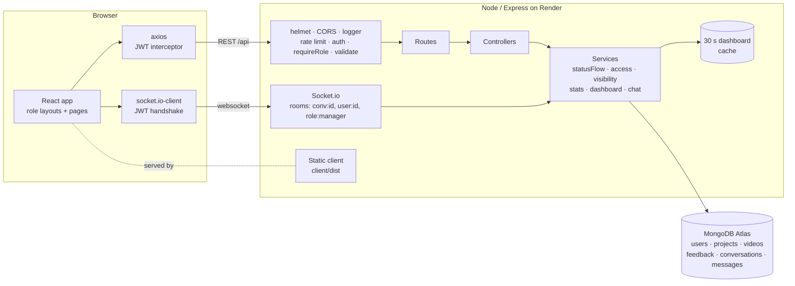

# MayKraft Studios — Studio Platform

**Purpose · Virality · Quality**

A production-management platform for a video agency. Managers run every client, project and deadline from one dashboard. Editors get briefs and submit cuts. Clients review and approve their films. Feedback and chat happen in real time.

> **Live app:** https://maykraft-studios.onrender.com · **Repo:** https://github.com/ashmitraj13/MayKraft-Studios-Platform · **Demo video:** _coming soon_
>
> Hosted on Render's free plan: the first visit after it has been idle can take 30–50 seconds to wake up. Demo logins are on each login page ("click to fill").


---

## Problem statement

A small video agency like MayKraft Studios runs dozens of videos at once for several brands. Each video moves from raw footage → editor → internal review → client review → revisions → delivery. Today that lives in WhatsApp groups, Drive folders and spreadsheets, which causes three recurring problems:

1. **Missed deadlines nobody saw coming.** An editor's deadline is often set *after* the date the client was promised, or a cut is overdue, and the manager only finds out when the client asks.
2. **Feedback gets lost or goes to the wrong person.** Client notes ("logo bigger at 0:41") get buried in chats, or reach the editor directly with no producer in between. Nobody can tell which notes apply to which version.
3. **Clients and editors see the wrong things.** Clients shouldn't see internal drafts, editor names or internal deadlines. Editors shouldn't see other editors' work or talk to clients directly.

## Target users

| User | Who they are | What they need |
|---|---|---|
| **Manager / producer** | Runs the studio (seeded account) | One screen showing every client's progress and which videos are at risk; assigning editors fairly; reviewing cuts |
| **Editor** | In-house or freelance video editor | Their own queue with footage, brief, deadline countdown, a place to submit versions, and notes for each version |
| **Client** | A brand (café chain, ed-tech, D2C…) | Project progress, a simple way to watch a cut and approve or request changes, and a line to their producer |

## Solution

One web app with **three role-specific workspaces** on top of a single video workflow:

- Every video follows an **enforced state machine** (footage → assigned → in progress → submitted → review → approved → delivered). Only the right role can make each move, and every move is recorded.
- The **manager dashboard** is computed by one MongoDB aggregation pipeline. It compares each editor deadline with the real client deadline, works out the buffer in days, and flags each video **green / amber / red**, so risk shows up before a deadline is missed.
- **Visibility is enforced on the server.** Clients only ever receive client-safe fields and statuses. Editors only receive their own videos and the manager's notes. Client feedback always goes through the manager.
- **Real-time chat** (Socket.io) is limited to manager↔editor and manager↔client. Messages can be tagged to a specific video and are saved in MongoDB.

---

## Core workflows

These are the five workflows the product is built around. Each one works end to end and is covered by tests.

| # | Workflow | Path through the app |
|---|---|---|
| 1 | **Set up work** | Manager creates a client account → creates a project (total videos, client deadline) → adds videos with footage link, brief and references |
| 2 | **Assign with deadline safety** | Manager picks an editor from a dropdown showing each editor's live workload and on-time % → sets an editor deadline → the server returns a **warning** if it's after the client deadline (saved, but flagged red) → can reassign later (history kept) |
| 3 | **Edit → internal review loop** | Editor starts work → submits version *n* (link + notes) → manager approves, requests changes (notes + timestamp, saved against that version), or sends it to the client |
| 4 | **Client review → delivery** | Client watches the cut → approves or requests changes with an optional `01:15` timestamp → the manager forwards notes to the editor (the editor never sees client feedback directly) → manager marks it delivered with a final link |
| 5 | **Monitor & communicate** | Manager dashboard with progress, status counts and flags, filterable by client, editor, status and overdue-only, cached for 30 seconds → real-time chat with typing, read receipts, unread counts and video tags → live notifications when any video changes |

## Key features

**Manager**
- Client dashboard: one card per client; for each project a progress bar and status counts; for each video the editor deadline next to the client deadline, the buffer in days and a 🟢🟠🔴 flag
- Filters by client, editor, status and overdue-only; summary tiles (at risk, tight, awaiting review…)
- Clients, projects, videos: create, edit and delete (deleting a project also removes its videos and feedback)
- Assign or reassign editors with workload-aware choices; red warning when the deadline is unsafe
- Review actions that only offer moves that are currently allowed
- Editors page: active and completed counts, on-time % (first cut on or before the editor deadline), deactivate or reactivate accounts

**Editor**
- "Needs you / With the studio / Wrapped" queue with live countdowns
- Start work, submit versions, see the manager's notes grouped by version
- Never sees client feedback, internal notes or the real client deadline

**Client**
- Projects with progress and "N to review" badges
- Review page with embedded player (YouTube, Vimeo, Drive) or link, approve or request changes with a timestamp, final delivery link
- Only ever sees their own projects, and only videos that are in review, approved or delivered

**Everyone**
- Real-time chat, notifications bell, change password, works at phone width

| Manager dashboard | Video review (manager) |
|---|---|
|  |  |
| **Editor — My videos** | **Client — Review** |
|  |  |
| **Real-time chat** | **Mobile** |
|  |  |

---

## Tech stack

| Layer | Choice | Why |
|---|---|---|
| Frontend | React 18 + Vite, React Router 6, Tailwind CSS 3 | Three role-based layouts with protected routes; Tailwind keeps one consistent design system |
| Data fetching | axios with interceptors | One place to attach the JWT and to log out on 401 |
| Realtime | Socket.io 4 (server + client) | Rooms map naturally onto conversations; acks give delivery confirmation; falls back to polling |
| Backend | Node.js + Express 4 | Simple middleware chain for auth → role → validation → handler → error mapper |
| Database | MongoDB + Mongoose 8 | Videos embed their versions and status history (always read together); aggregation pipelines power the dashboard |
| Auth | JWT (Bearer) + bcrypt (`bcryptjs`) | Stateless sessions that also work for the socket handshake |
| Security | helmet (strict CSP), CORS allow-list, express-rate-limit, `validator` | See [Security](#security) |
| Tests | Jest, supertest, mongodb-memory-server, socket.io-client | Tests run against a real MongoDB in memory and never touch real data |
| CI | GitHub Actions | Runs the 81 API tests and the client build on every push |
| Hosting | Render (one service) + MongoDB Atlas | The API also serves the built React app, so the whole product has one URL and needs no cross-origin setup |

---

## Architecture



### Request flow

`request → helmet/CORS → logger → [rate limit] → auth (verify JWT, load user) → requireRole → validate(body) → validateObjectId → controller → service → Mongo → { data } | error → errorHandler → { message, error }`

### Main components

| Component | File(s) | Responsibility |
|---|---|---|
| App / server split | `server/src/app.js`, `server/src/server.js` | `app.js` builds Express and never listens, so tests import it directly. `server.js` creates the HTTP server, attaches Socket.io and listens |
| Status machine | `services/statusFlow.js` | One table `from → { to: [roles] }`. Invalid move → 400, wrong role → 403. Every move is written to `statusHistory` |
| Access control | `services/access.js` | Loads a project or video only if this user may see it, otherwise returns "not found" (so it never reveals that the resource exists) |
| Field visibility | `services/visibility.js` | Shapes each video for the requesting role (removes editor and internal fields for clients, client deadline for editors) |
| Dashboard | `services/dashboard.js` | One aggregation: `$lookup` videos + editor → `$addFields` buffer, overdue and flag → `$group` status counts → `$facet` per client + summary |
| Cache | `services/cache.js` | In-memory TTL cache (30 s), key = filters. A Mongoose plugin clears it after **any** write to users, projects or videos |
| Stats | `services/stats.js` | Aggregations for client totals, project progress and editor workload / on-time % |
| Chat | `services/chat.js`, `sockets/*` | Shared by REST and socket handlers: role rule (exactly one manager per conversation), participant checks, saved messages, read receipts, pagination |
| Errors | `middleware/errorHandler.js` | `ValidationError` → 400, E11000 → 409 ("Email already registered"), `HttpError` → its status, anything else → 500 |
| Client state | `client/src/context/*` | `AuthContext` (token + user), `RealtimeContext` (socket, notifications, unread counts), `ToastContext` |

### Data model

```mermaid
erDiagram
  USER ||--o{ PROJECT : "client owns"
  PROJECT ||--o{ VIDEO : contains
  USER ||--o{ VIDEO : "editor assigned"
  VIDEO ||--o{ FEEDBACK : has
  USER ||--o{ FEEDBACK : writes
  CONVERSATION ||--o{ MESSAGE : contains
  USER }o--o{ CONVERSATION : participates
  MESSAGE }o--o| VIDEO : "tags (optional)"

  USER { string name; string email UK; string passwordHash; enum role; string company; bool isActive }
  PROJECT { string title; ObjectId client; int totalVideos; date clientDeadline; enum status }
  VIDEO { string title; string footageLink; ObjectId assignedEditor; date editorDeadline; date clientDeadline; enum status; array versions; array statusHistory }
  FEEDBACK { ObjectId video; ObjectId author; enum role; string text; string timestampInVideo; int versionNumber; bool resolved }
  CONVERSATION { enum type; array participants; string participantKey UK; date lastMessageAt }
  MESSAGE { ObjectId conversation; ObjectId sender; string text; ObjectId video; array readBy }
```

### Engineering decisions

- **Versions and status history are embedded in the video document.** They're always read with the video and are bounded in size. Feedback and messages are separate collections because they grow without limit and are queried on their own.
- **Lookups and stats happen in MongoDB, not in JavaScript loops.** The dashboard is a single round trip.
- **"Not found" instead of "forbidden" for other people's resources**, so the API doesn't reveal what exists. 403 is kept for wrong-role actions.
- **Duplicates are prevented by unique indexes**, not by "check then insert": `email` is unique on users, and `participantKey` (the sorted pair of ids) is unique on conversations, so two people can never end up with two threads.
- **The cache is cleared by a Mongoose plugin**, so no future code path can forget to invalidate it.
- **One REST and socket service for chat**, so the role rules can't drift apart between the two entry points.

---

## Local setup

Requires Node 18+ (22 recommended).

```bash
git clone <repo-url> && cd maykraft-platform
npm install            # root tools (concurrently)
npm run install:all    # server + client dependencies

# Quickest: no MongoDB needed. Runs on an in-memory DB that is auto-seeded.
npm run dev:demo
```

Open **http://localhost:5173**. The API is on http://localhost:5050 (port 5000 is avoided because macOS uses it for AirPlay).

**With a real MongoDB (local or Atlas):**

```bash
cp server/.env.example server/.env   # set MONGO_URI, JWT_SECRET; USE_MEMORY_DB=false
npm run seed                         # wipes the database and loads demo data
npm run dev
```

**Production-style single server:**

```bash
npm run build                        # builds client/dist
npm start --prefix server            # serves API + app on http://localhost:5050
```

**Tests:**

```bash
npm test        # 81 API tests: auth, roles, workflow, dashboard, cache, chat, sockets, seed
```

## Demo credentials

| Role | Email | Password |
|---|---|---|
| Manager | manager@maykraft.studio | Manager@123 |
| Editor | kabir@maykraft.studio · isha@maykraft.studio · arjun@maykraft.studio | Editor@123 |
| Client — Chaiwala Junction (café chain) | rohan@chaiwalajunction.in | Client@123 |
| Client — Vidya Spark Academy (ed-tech) | priya@vidyaspark.in | Client@123 |
| Client — Kesari Naturals (D2C) | meera@kesarinaturals.in | Client@123 |

Every login page has a "click to fill" demo button. The seed creates 5 projects and 20 videos across every status. Some are overdue, one has an editor deadline after its client deadline, and there are 5 chat threads.

## Environment variables

**server/.env** (template: `server/.env.example`)

| Variable | Required | Example | Notes |
|---|---|---|---|
| `MONGO_URI` | yes | `mongodb+srv://…/maykraft` | Atlas connection string |
| `JWT_SECRET` | yes (prod) | long random string | The server refuses to start in production without it |
| `JWT_EXPIRES_IN` | no | `7d` | |
| `PORT` | no | `5050` | Render sets this automatically |
| `CLIENT_URL` | no | `https://maykraft.onrender.com` | CORS allow-list, comma-separated; only needed if the frontend is hosted on a different origin |
| `USE_MEMORY_DB` | no | `false` | `true` = in-memory demo DB, auto-seeded |
| `SERVE_CLIENT` | no | `true` | Set to `false` to serve the API only |

**client/.env** (template: `client/.env.example`)

| Variable | Example | Notes |
|---|---|---|
| `VITE_API_URL` | _(empty)_ | Leave empty when the API serves the client, or in dev (Vite proxies `/api`) |
| `VITE_SHOW_DEMO` | `true` | Show the demo credentials on login pages |

## Deployment

Hosted as **one Render web service** (API + Socket.io + built React app) with **MongoDB Atlas**. `render.yaml` is a ready-made Blueprint. Step-by-step instructions are in **[DEPLOYMENT.md](DEPLOYMENT.md)**.

- Live: https://maykraft-studios.onrender.com
- Health check: https://maykraft-studios.onrender.com/api/health

---

## Security

- Passwords are hashed with bcrypt (10 rounds). `passwordHash` is never selected by default and is stripped from every JSON response.
- JWTs are signed with `JWT_SECRET` from the environment. The socket handshake verifies the same token and reloads the user, so deactivated accounts lose access immediately.
- Authorization is checked on every route (`requireRole`) and every resource (`services/access.js`). Visibility is enforced on the server, not just hidden in the UI.
- Input is validated by `validate` middleware (`validator.isEmail`, `isURL` with http/https only, dates, enums, timestamps). Malformed ObjectIds return 404, never 500.
- Login, register and change-password are rate-limited (20 per 15 minutes per IP). helmet sets a strict Content-Security-Policy. CORS uses an allow-list.
- No secrets are in the repo: `.env` is git-ignored and only `.env.example` templates are committed. The seed script refuses to wipe a production database without `--force`.

## API reference

All routes start with `/api`. Success: `{ data }` · Error: `{ message, error }`.
Status codes: 201 create · 200 read/update/delete · 400 validation or invalid transition · 401 missing or invalid token · 403 wrong role · 404 not found (including malformed ids) · 409 duplicate · 429 rate limited · 500 unexpected.

| Method | Path | Who | Purpose |
|---|---|---|---|
| GET | `/health` | public | Health check |
| POST | `/auth/login` | public · rate-limited | `{ email, password, role? }` → `{ data: { token, user } }` |
| POST | `/auth/register` | manager · rate-limited | Create an editor or client account |
| GET | `/auth/me` | any | Current user |
| PATCH | `/auth/password` | any · rate-limited | `{ currentPassword, newPassword }` |
| GET | `/users?role=&q=` · PATCH `/users/:id` | manager | List, edit or deactivate users |
| GET | `/managers` | any | Managers you can chat with |
| GET | `/clients` · `/clients/:id` | manager | Clients with stats, or one client with their projects |
| GET | `/editors` · `/editors/:id` | manager | Workload, completed count, on-time % |
| GET / POST | `/projects` | scoped / manager | List (by role) or create |
| GET / PATCH / DELETE | `/projects/:id` | scoped / manager | Project with stats and the videos you're allowed to see |
| GET / POST | `/projects/:projectId/videos` | scoped / manager | List or add videos |
| GET | `/videos?status=&editor=&project=` | scoped | My videos (editor), all (manager) |
| GET / PATCH / DELETE | `/videos/:id` | scoped / manager | Includes `allowedNext` for the caller's role |
| PATCH | `/videos/:id/assign` | manager | `{ editorId, editorDeadline }` → may include `warning` |
| PATCH | `/videos/:id/status` | by role | `{ status, note?, timestampInVideo?, deliveryLink? }` |
| POST | `/videos/:id/versions` | assigned editor | `{ link, notes }` → submitted |
| GET / POST | `/videos/:id/feedback` | scoped | Feedback list or create |
| PATCH | `/feedback/:id/resolve` | manager | Toggle resolved |
| GET | `/dashboard/clients?client=&editor=&status=&overdue=&flag=` | manager | Aggregated dashboard + `summary` + `fromCache` |
| GET / POST | `/conversations` | any | My threads with unread counts, or open one `{ participantId }` |
| GET | `/conversations/:id/messages?before=&limit=30` | participants | Paginated history |
| POST | `/conversations/:id/messages` | participants | REST fallback for sending |
| PATCH | `/conversations/:id/read` | participants | Mark as read |

**Socket events**

- Client → server: `join_conversation`, `send_message` (ack), `typing`, `mark_read`
- Server → client: `new_message`, `typing`, `messages_read`, `conversation_updated`, `video_updated`, `feedback_added`, `presence`

**Video state machine**

```
footage_uploaded → assigned → in_progress → submitted ─┬→ approved → delivered
                                 ▲              │       ├→ changes_requested → (in_progress | submitted)
                                 │              │       └→ client_review ─┬→ approved
                                 └──────────────┘                         └→ client_changes → changes_requested
```

## Project structure

```
client/                 React app
  src/api               axios instance (token + 401 logout) and endpoint helpers
  src/context           Auth, Toast, Realtime (socket, notifications, unread)
  src/components        layout, ui, video, chat, forms
  src/pages             Landing, Login, manager/*, editor/*, client/*, ChatPage
server/
  src/app.js            Express app (no listen)
  src/server.js         http server + Socket.io + listen; exports { server, io }
  src/config            env, db
  src/models            User, Project, Video, Feedback, Conversation, Message
  src/controllers       request handlers
  src/routes            routers + validation rules
  src/middleware        auth, requireRole, validate, validateObjectId, logger, errorHandler, rateLimit
  src/services          statusFlow, access, visibility, stats, dashboard, cache, chat
  src/sockets           handshake auth, presence map, chat handlers, emitter
  src/seed              demo data + seed script
  tests/                Jest + supertest + socket tests
.github/workflows/ci.yml   tests + build on every push
render.yaml                Render Blueprint (one service)
```

## AI usage & originality

AI tools (Claude) were used as an engineering assistant for code generation, refactoring, tests and documentation. The product idea, workflows and requirements come from MayKraft Studios' real production process. No existing open-source project was used as a base; the libraries used are listed in the tech stack above.
