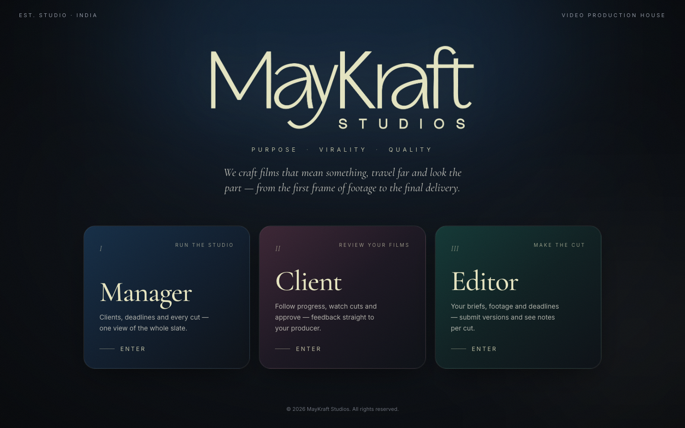
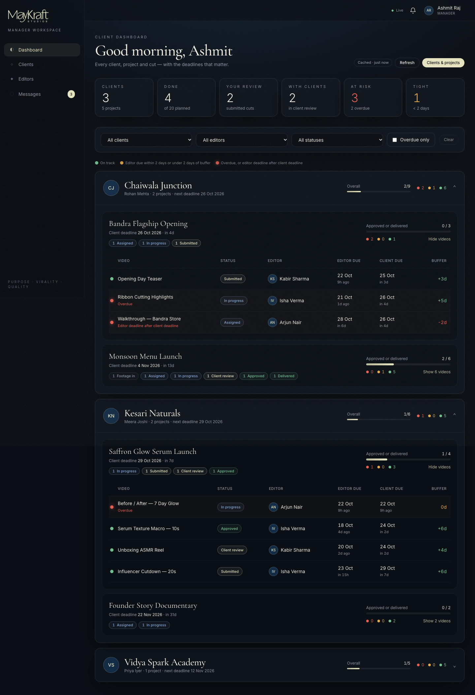
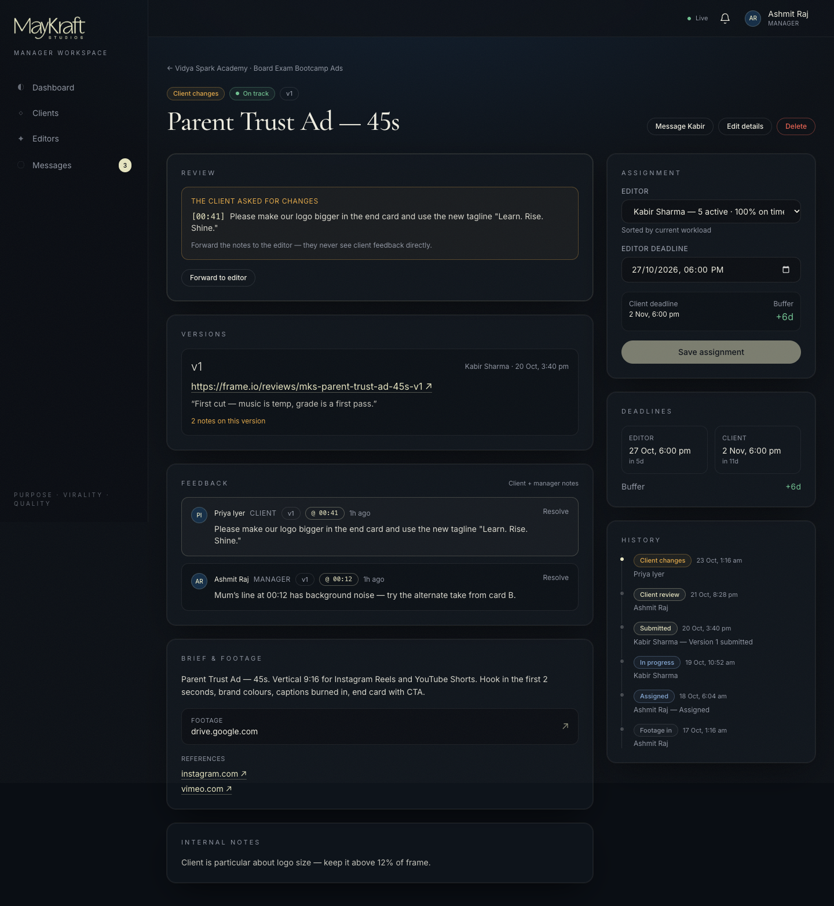
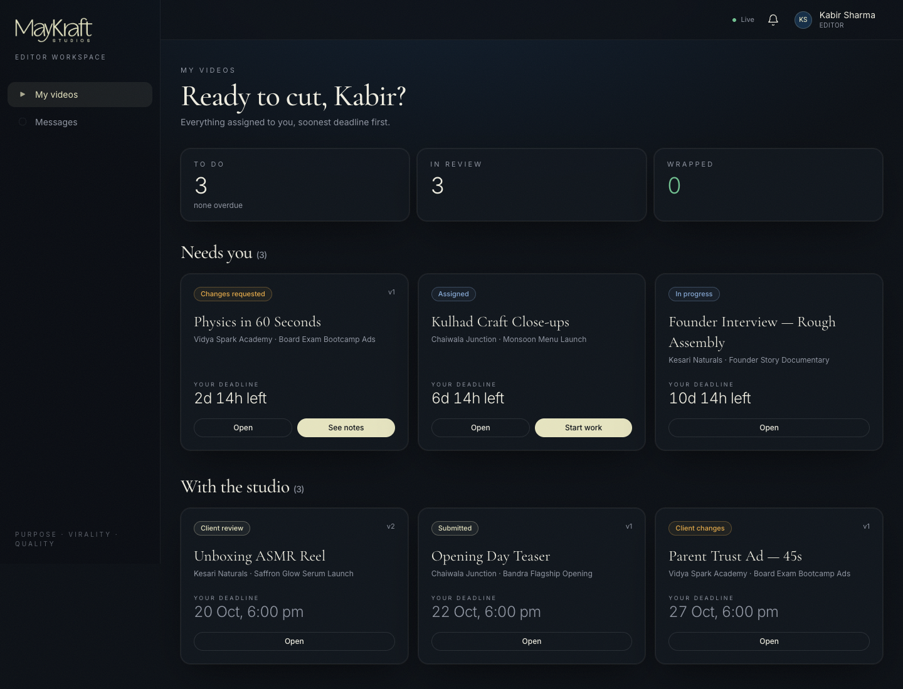
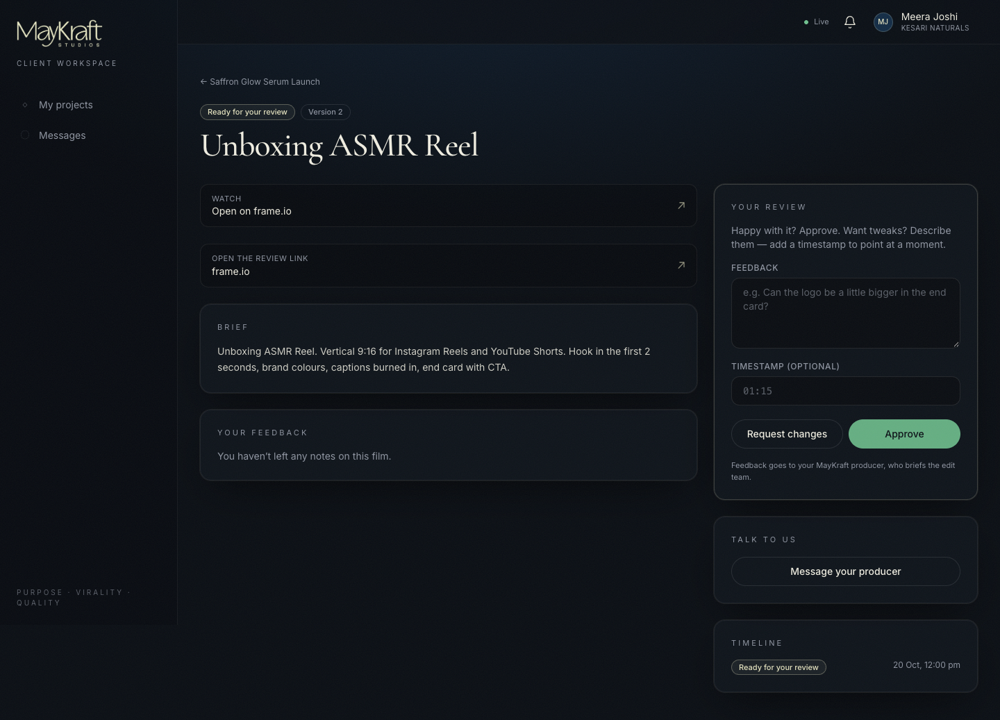
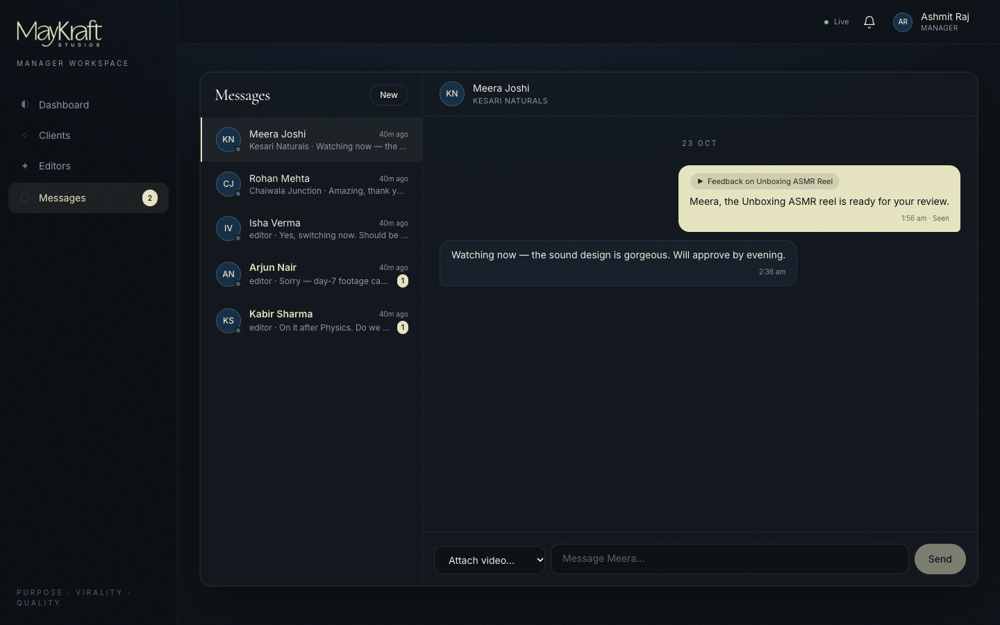
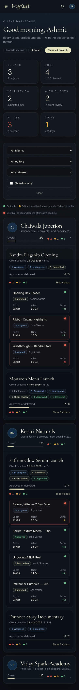

# MayKraft Studios — Studio Platform

**Purpose · Virality · Quality**

A full-stack MERN platform for a video production agency. Managers run clients, projects and deadlines; editors receive briefs and submit cuts; clients review and approve their films. Everyone chats in real time.



| Manager dashboard | Video review (manager) |
|---|---|
|  |  |
| **Editor — My videos** | **Client — Review** |
|  |  |
| **Real-time chat** | **Mobile** |
|  |  |

---

## Features

**Manager**
- Client dashboard: one card per client, with a progress bar for each project and counts per status. For each video it shows the editor deadline next to the client deadline, the buffer in days, and a 🟢🟠🔴 flag.
- Filters by client, editor and status, plus "overdue only". All of it is built with one MongoDB aggregation, cached for 30 seconds (`fromCache`) and cleared on any write.
- Clients, projects and videos: create and edit, with footage links, briefs and reference links.
- Assign or reassign editors from a dropdown that shows each editor's workload and on-time %. If the editor deadline falls after the client deadline, it is still saved, but you get a red warning.
- Review: approve, request changes (with notes and a timestamp), send to the client, pass client changes on to the editor, and deliver.
- Editors page: active and completed counts and on-time percentage.

**Editor**
- My videos, with live countdowns. Start work, submit versions (link and notes), and see the manager's notes for each version.
- Sees only their own videos. Never sees client feedback, internal notes or the real client deadline.

**Client**
- My projects: progress, deadline, and which films are ready for review.
- Review a film (YouTube, Vimeo and Drive links embed in the page), then approve or request changes with an optional `01:15` timestamp.
- Sees only their own projects, and only videos in client review, approved or delivered. Never sees editor names or editor deadlines.

**Chat (Socket.io)**
- JWT in the socket handshake, one room per conversation, `send_message → saved in MongoDB → new_message`, a typing indicator, read receipts, unread counts, and a "feedback on video X" chip.
- Chats are always between a manager and one other person. The server refuses editor↔client chats.

---

## Tech stack

| Layer | Tools |
|---|---|
| Frontend | React 18 (Vite), React Router 6, Tailwind CSS 3, axios, socket.io-client |
| Backend | Node.js, Express 4, Mongoose 8, Socket.io 4 |
| Auth | JWT (Bearer), bcrypt hashing (`bcryptjs`), role middleware |
| Security | helmet, CORS limited to `CLIENT_URL`, express-rate-limit on login and register, `validator` |
| Tests | Jest, supertest, mongodb-memory-server, socket.io-client |
| Hosting | Render (API), Vercel (web), MongoDB Atlas (DB) |

---

## Quick start

Requires Node 18+.

```bash
npm install            # root (installs concurrently)
npm run install:all    # server + client

# Easiest: no MongoDB needed. Runs on an in-memory DB that is seeded automatically.
npm run dev:demo
```

Open http://localhost:5173. The API runs on http://localhost:5050. Port 5000 is avoided because macOS uses it for AirPlay.

### Using a real MongoDB (local or Atlas)

```bash
cp server/.env.example server/.env   # set MONGO_URI and JWT_SECRET, USE_MEMORY_DB=false
npm run seed                         # wipes and loads demo data
npm run dev
```

### Tests

```bash
npm test        # 78 tests, in-memory MongoDB, never touches real data
```

---

## Demo credentials

| Role | Email | Password |
|---|---|---|
| Manager | manager@maykraft.studio | Manager@123 |
| Editor | kabir@maykraft.studio | Editor@123 |
| Editor | isha@maykraft.studio | Editor@123 |
| Editor | arjun@maykraft.studio | Editor@123 |
| Client (Chaiwala Junction, café chain) | rohan@chaiwalajunction.in | Client@123 |
| Client (Vidya Spark Academy, ed-tech) | priya@vidyaspark.in | Client@123 |
| Client (Kesari Naturals, D2C) | meera@kesarinaturals.in | Client@123 |

Each login page has a "click to fill" demo button. Hide it with `VITE_SHOW_DEMO=false`.

The seed creates 5 projects and 20 videos across every status. Some are overdue, one has an editor deadline after its client deadline, and there are 5 chat threads.

---

## Environment variables

**server/.env**

| Variable | Example | Notes |
|---|---|---|
| `PORT` | `5050` | Render sets this automatically |
| `MONGO_URI` | `mongodb+srv://…/maykraft` | Atlas connection string |
| `JWT_SECRET` | long random string | **Required** in production |
| `JWT_EXPIRES_IN` | `7d` | |
| `CLIENT_URL` | `https://maykraft.vercel.app` | Used for CORS; a comma-separated list is allowed |
| `USE_MEMORY_DB` | `false` | `true` = in-memory demo DB, auto-seeded |

**client/.env**

| Variable | Example | Notes |
|---|---|---|
| `VITE_API_URL` | `https://maykraft-api.onrender.com` | Leave empty in dev (Vite proxies `/api`) |
| `VITE_SHOW_DEMO` | `true` | Show demo credentials on login pages |

---

## API

All routes start with `/api`. Responses look like `{ data }` on success and `{ message, error }` on error.
Status codes: 201 create · 200 read/update/delete · 400 validation · 401 no or invalid token · 403 wrong role · 404 not found (including malformed ids) · 409 duplicate · 500 unexpected.

| Method | Path | Who | Purpose |
|---|---|---|---|
| GET | `/health` | public | Health check |
| POST | `/auth/login` | public · rate-limited | `{ email, password, role? }` → `{ data: { token, user } }` |
| POST | `/auth/register` | manager · rate-limited | Create an editor or client account |
| GET | `/auth/me` | any | Current user |
| GET | `/users?role=&q=` | manager | List users |
| GET / PATCH | `/users/:id` | manager | View, edit or deactivate a user |
| GET | `/managers` | any | Managers you can chat with |
| GET | `/clients` · `/clients/:id` | manager | Clients with stats, or one client with their projects |
| GET | `/editors` · `/editors/:id` | manager | Workload, completed count, on-time % |
| GET / POST | `/projects` | scoped / manager | List (by role) or create |
| GET / PATCH / DELETE | `/projects/:id` | scoped / manager | Project and its visible videos |
| GET / POST | `/projects/:projectId/videos` | scoped / manager | List or add videos |
| GET | `/videos?status=&editor=&project=` | scoped | My videos (editor), all (manager) |
| GET / PATCH / DELETE | `/videos/:id` | scoped / manager | |
| PATCH | `/videos/:id/assign` | manager | `{ editorId, editorDeadline }` → may return `warning` |
| PATCH | `/videos/:id/status` | by role | `{ status, note?, timestampInVideo?, deliveryLink? }` |
| POST | `/videos/:id/versions` | assigned editor | `{ link, notes }` → submitted |
| GET / POST | `/videos/:id/feedback` | scoped | Feedback list or create |
| PATCH | `/feedback/:id/resolve` | manager | Toggle resolved |
| GET | `/dashboard/clients?client=&editor=&status=&overdue=&flag=` | manager | Aggregated dashboard + `summary` + `fromCache` |
| GET / POST | `/conversations` | any | My threads with unread counts, or open one `{ participantId }` |
| GET | `/conversations/:id/messages?before=&limit=30` | participants | Paginated history |
| POST | `/conversations/:id/messages` | participants | REST fallback for sending |
| PATCH | `/conversations/:id/read` | participants | Mark as read |

**Socket events**

- Client → server: `join_conversation`, `send_message` (with ack), `typing`, `mark_read`
- Server → client: `new_message`, `typing`, `messages_read`, `conversation_updated`, `video_updated`, `feedback_added`, `presence`

### Video workflow

```
footage_uploaded → assigned → in_progress → submitted ─┬→ approved → delivered
                                 ▲              │       ├→ changes_requested → (in_progress | submitted)
                                 │              │       └→ client_review ─┬→ approved
                                 └──────────────┘                         └→ client_changes → changes_requested
```

Every move is checked against one table in `server/src/services/statusFlow.js`, which lists who may make each move. An invalid move returns 400. A valid move by the wrong role returns 403.

---

## Project structure

```
client/                React app
  src/api              axios instance (token + 401 logout) and endpoint helpers
  src/context          Auth, Toast, Realtime (socket, notifications, unread)
  src/components       layout (Sidebar, TopBar, ProtectedRoute), ui, video, chat, forms
  src/pages            Landing, Login, manager/*, editor/*, client/*, ChatPage
server/
  src/app.js           Express app (no listen); exported as module.exports and .app
  src/server.js        http server + Socket.io + listen; exports { server, io }
  src/config           env, db
  src/models           User, Project, Video, Feedback, Conversation, Message
  src/controllers      request handlers
  src/routes           routers + validation rules
  src/middleware       auth, requireRole, validate, validateObjectId, logger, errorHandler, rateLimit
  src/services         statusFlow, access, visibility, stats, dashboard, cache, chat
  src/sockets          handshake auth, presence map, chat handlers, emitter
  src/seed             demo data + seed script
  tests/               Jest + supertest + socket tests
```

Deployment steps: see [DEPLOYMENT.md](DEPLOYMENT.md).
